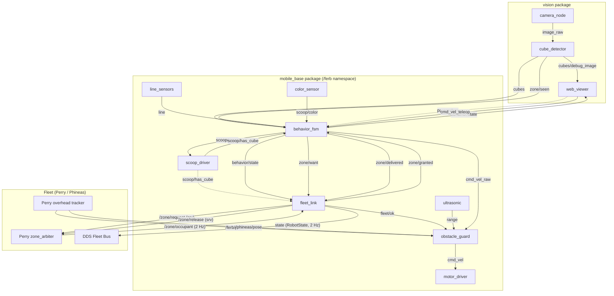
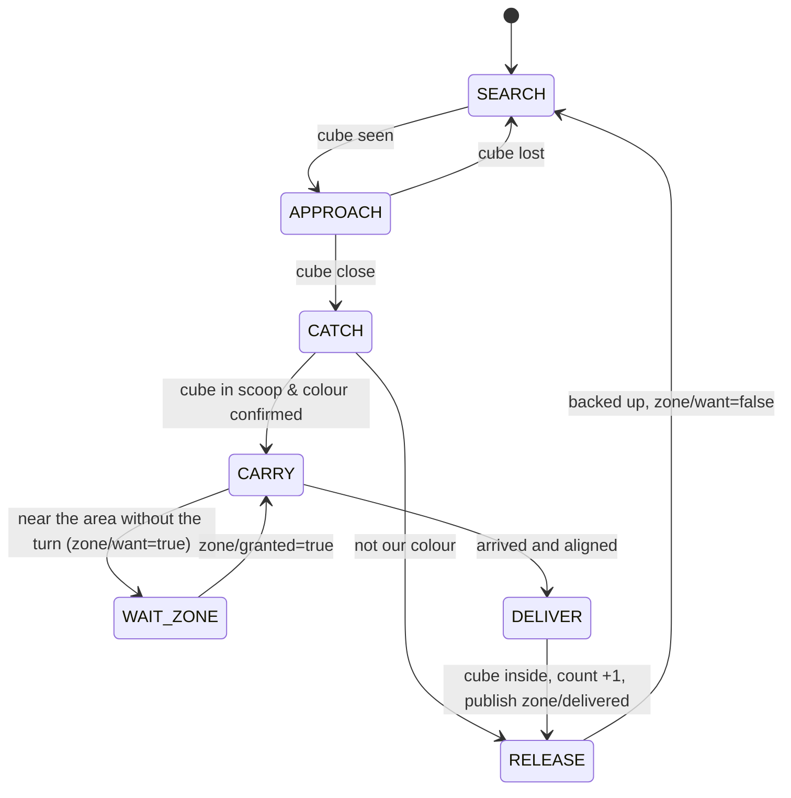

# Collector architecture

System architecture and ROS 2 graph for the collector robot (**Ferb**). Role 3 maintains it; if you change a topic, message, service or node contract, update this document in the same PR.

## Layers

```
Raspberry Pi 5 → Cokoino HAT (2× DRV8833) → Ubuntu 26.04 → ROS 2 Lyrical → Python nodes
```

All collector nodes execute inside namespace `/ferb` (e.g. `/ferb/cmd_vel`, `/ferb/fleet/ok`). Only inter-robot fleet topics/services (`/zone/*`, peer pose `/phineas/pose`) operate on absolute global names.

## Nodes



In simulation, `webots_bridge` (package `recolector_sim`) replaces `camera_node`,
`ultrasonic` and `motor_driver`: it publishes `image_raw` and `range` and listens to `cmd_vel`, so the
rest of the nodes are the same as on the real robot.

| Package | Node | What it does | Owner |
|---|---|---|---|
| `mobile_base` | `motor_driver` | `cmd_vel` → PWM for the 4 motors; brakes when no commands arrive | role 1 |
| `mobile_base` | `line_sensors` | 1 bottom TCRT5000 → `line` | role 1 |
| `mobile_base` | `ultrasonic` | HC-SR04 → `range` | role 1 |
| `mobile_base` | `scoop_driver` | scoop servo + presence IR | role 1 |
| `mobile_base` | `color_sensor` | TCS34725 → colour of the cube in the scoop | role 2 |
| `mobile_base` | `obstacle_guard` | limits velocity via ultrasonic range, enforces fleet heartbeat (`fleet/ok`), and applies `PeerAvoidance` using overhead poses | role 3 |
| `mobile_base` | `behavior_fsm` | state machine (search, approach, catch, carry, wait for the zone, deliver, release, line escape) and cube count | role 3 |
| `mobile_base` | `fleet_link` | bridges local FSM and guard with fleet: monitors `/zone/occupant` heartbeat, requests/releases zone asynchronously, publishes `/ferb/state`, `fleet/ok`, and `zone/granted` | role 3 |
| `vision` | `camera_node` | camera → `image_raw` | role 2 |
| `vision` | `cube_detector` | cubes by colour → `cubes` and `cubes/debug_image`; delivery area → `zone/seen` | role 2 |
| `vision` | `web_viewer` | web page (port 8080): video, cubes, state; changes `behavior_fsm` parameters; manual control with WASD | role 2 |
| `recolector_sim` | `webots_bridge` | simulation only: Webots ↔ `image_raw`, `range`, `cmd_vel` | role 4 |

## Topics and services

Unless noted with a leading `/`, all names are local to the robot namespace (`/ferb`).

| Name | Type | Direction / Connection | Description |
|---|---|---|---|
| `cmd_vel_teleop` | `geometry_msgs/Twist` | `web_viewer` → `behavior_fsm` | WASD teleoperation; takes priority while arriving |
| `cmd_vel_raw` | `geometry_msgs/Twist` | `behavior_fsm` → `obstacle_guard` | Unfiltered velocity commands from the FSM |
| `cmd_vel` | `geometry_msgs/Twist` | `obstacle_guard` → `motor_driver` | Safety-filtered velocity commands |
| `line` | `recolector_interfaces/LineSensors` | `line_sensors` → `behavior_fsm` | Bottom TCRT5000: `black` is true over the tape (the border) |
| `range` | `sensor_msgs/Range` | `ultrasonic` → `obstacle_guard`, `behavior_fsm` | Ultrasonic distance in front of robot |
| `scoop/lower` | `std_msgs/Bool` | `behavior_fsm` → `scoop_driver` | Commands servo to lower (true) or raise (false) scoop |
| `scoop/has_cube` | `std_msgs/Bool` | `scoop_driver` → `behavior_fsm`, `fleet_link` | IR sensor detection of cube in scoop |
| `scoop/color` | `std_msgs/String` | `color_sensor` → `behavior_fsm` | TCS34725 detected colour of carried cube |
| `image_raw` | `sensor_msgs/Image` | `camera_node` → `cube_detector` | Raw camera stream |
| `cubes` | `recolector_interfaces/CubeDetectionArray` | `cube_detector` → `behavior_fsm`, `web_viewer` | Detected cubes ordered by distance |
| `cubes/debug_image` | `sensor_msgs/Image` | `cube_detector` → `web_viewer` | Image annotated with bounding boxes and the delivery area |
| `zone/seen` | `recolector_interfaces/CubeDetectionArray` | `cube_detector` → `behavior_fsm` | Delivery area: empty when not in view, else one entry; `color` is `floor` (area paper) or `gate` (landmarks) |
| `behavior/state` | `std_msgs/String` (JSON) | `behavior_fsm` → `web_viewer`, `fleet_link` | Local FSM state (`SEARCH`, `APPROACH`, etc.) |
| `count` | `std_msgs/UInt32` | `behavior_fsm` → external | Local count of delivered cubes |
| `fleet/ok` | `std_msgs/Bool` | `fleet_link` → `obstacle_guard` | True if `/zone/occupant` heartbeat is fresh (<2.0 s) |
| `zone/want` | `std_msgs/Bool` | `behavior_fsm` → `fleet_link` | High when the FSM wants the delivery area (published on change) |
| `zone/delivered` | `std_msgs/String` | `behavior_fsm` → `fleet_link` | Colour name of the cube delivered inside the area |
| `zone/granted` | `std_msgs/Bool` | `fleet_link` → `behavior_fsm` | True when Ferb currently holds the delivery area lease |
| `state` | `multirobot_interfaces/RobotState` | `fleet_link` → fleet | Standardized fleet state published at 2 Hz (`/ferb/state`) |
| `/zone/occupant` | `std_msgs/String` | Perry `zone_arbiter` → `fleet_link` | Current lease occupant (2 Hz, reliable, transient_local) |
| `/zone/request` | `multirobot_interfaces/RequestZone` (srv) | `fleet_link` → Perry `zone_arbiter` | Asynchronous service call to request delivery square lease |
| `/zone/release` | `multirobot_interfaces/ReleaseZone` (srv) | `fleet_link` → Perry `zone_arbiter` | Asynchronous service call to release delivery square lease |
| `/ferb/pose` | `multirobot_interfaces/RobotPose` | Perry overhead tracker → `obstacle_guard` | Own pose in table frame (meters, radians) |
| `/phineas/pose` | `multirobot_interfaces/RobotPose` | Perry overhead tracker → `obstacle_guard` | Peer pose used for `PeerAvoidance` |

## Messages

- `recolector_interfaces/CubeDetection`: `color`, `bearing_rad` (positive = left), `distance_m` (along the floor, from the camera to the bottom edge of the cube), `u`, `v`, `width_px`, `height_px`.
- `recolector_interfaces/CubeDetectionArray`: the image `header` and `cubes[]`, from nearest to farthest. Also used by `zone/seen` (0 or 1 entry: the area's bearing, distance, `v` of its near edge and box size).
- `recolector_interfaces/LineSensors`: `header` and `black` (bottom TCRT5000 over the tape).
- `multirobot_interfaces`: Vendored from upstream `ucab-multirobot` (commit `09d0f16`). Defines `RobotState`, `RobotPose`, `CubeDetection`, `CubeDetectionArray`, `RequestZone`, and `ReleaseZone`.

## Code layout

Each node file only wires ROS to pure logic; the logic lives in modules without `rclpy`, with tests in `test/`. Shared names and helpers:

| Package | Module | Responsibility |
|---|---|---|
| `recolector_common` | `params.py` | declare and read ROS parameters from a dataclass (field name = parameter name, optional `prefix`) |
| `recolector_common` | `node_utils.py` | `now_s(node)` and `spin_node(factory)` |
| `mobile_base` | `states.py` | `State` (local behaviour states) and `FleetState` (shared vocabulary) |
| `mobile_base` | `topics.py` | topic and service names, QoS depths |
| `mobile_base` | `approach.py` | SEARCH → APPROACH → ARRIVED controller, `drive_toward` |
| `mobile_base` | `collector.py` | full collector FSM on top of the approach (catch, carry, zone turn, deliver, release, line escape) |
| `mobile_base` | `scoop_color.py` | TCS34725 counts → colour name |
| `mobile_base` | `motor_hardware.py`, `sensor_hardware.py` | HAT motors, digital inputs, HC-SR04, SG90, TCS34725 (each with a fake) |
| `mobile_base` | `speed_limits.py` | ultrasonic forward limit |
| `mobile_base` | `fleet.py` | state mapping, heartbeat, zone lease client |
| `mobile_base` | `peer_avoidance.py` | peer collector avoidance and deadlock escape |
| `mobile_base` | `kinematics.py`, `mathutil.py` | mecanum kinematics, `clamp` and `wrap_angle` |
| `vision` | `hsv.py`, `camera_model.py` | HSV range parsing, pixel → floor geometry (no OpenCV) |
| `vision` | `color_detection.py`, `drawing.py` | colour detector (cubes, landmarks, area paper), debug-image drawing |
| `vision` | `zone.py` | delivery area locator (landmarks far, paper up close) and cubes-already-delivered filter |
| `vision` | `colors.py`, `topics.py` | colour names, topic names |
| `vision` | `web_server.py`, `frame_buffer.py` | HTTP routes of the viewer (no `rclpy`), latest-frame buffer |
| `tools/teleop_web_lib` | `autopilot.py`, `drive.py`, `motors.py`, ... | Auto mode state machine, control thread, motor drivers (see the package docstring) |

Parameters of every node are declared from dataclasses: `ApproachParams`, `CollectorParams`, `GuardParams`, `PeerAvoidanceParams`, `FleetLinkParams`, `MotorHardwareParams`, `ScoopColorParams`, `CameraParams`, `DetectionFilter`, `ZoneParams` and the node-level ones in each node file. Their defaults are the fallback; the real values are in the YAML.

## State machine

`mobile_base/approach.py` drives `SEARCH` (turns) → `APPROACH` → `ARRIVED` (stops at `stop_distance_m` from the
nearest cube of `target_colors`); `mobile_base/collector.py` adds the rest (states in `mobile_base/states.py`):
`CATCH` (blind push into the scoop, optional FC-51 / TCS34725 confirmation), `CARRY` (to the area from `zone/seen`),
`WAIT_ZONE` (stopped outside the area until `zone/granted`), `DELIVER` (blind push into the area, count +1),
`RELEASE` (scoop up, back up, turn) and `LINE_ESCAPE`. Plus `PAUSED` when `enabled` is false and `NO_CAMERA` if no
detections arrive while the state steers by the camera.
`MANUAL` while `cmd_vel_teleop` keeps arriving (WASD in the web viewer): it takes priority over everything
else, even when paused, and still goes through `obstacle_guard`.

Target colours: since 2026-10-29 Ferb collects **only yellow** (`target_colors: [yellow]`, also in `cube_detector`'s `color_names`). Earlier rule (2026-10-22): every colour except red.



In any state:
1. If a line sensor sees black, the robot backs up and turns inwards. The delivery area is a gap with no tape, so this also holds while delivering.
2. If the ultrasonic sensor detects an obstacle closer than `stop_distance_m`, `obstacle_guard` zeroes forward speed.
3. If `require_heartbeat` is active and `fleet/ok` is false (no `/zone/occupant` for >2.0 s), `obstacle_guard` halts forward velocity.
4. If peer pose is detected within ±60° cone, `PeerAvoidance` slows at 0.60 m, stops at 0.40 m, and escapes after 3.0 s deadlock by yielding.

## Localization

No wheel encoders or SLAM are used. The robot navigates reactively using the onboard camera (cubes and ArUco markers), bottom line sensors, front ultrasonic sensor, and the global pose published by Perry's overhead localization system (`/ferb/pose`).
