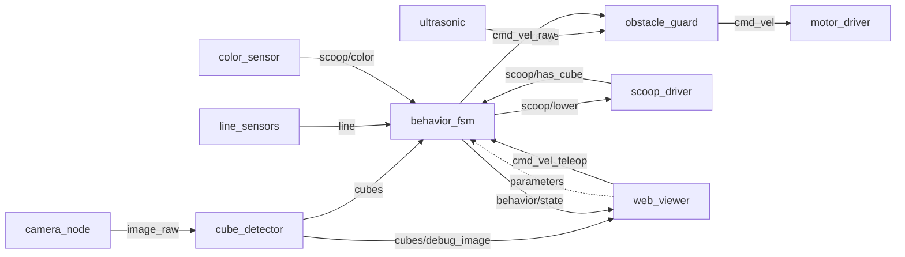
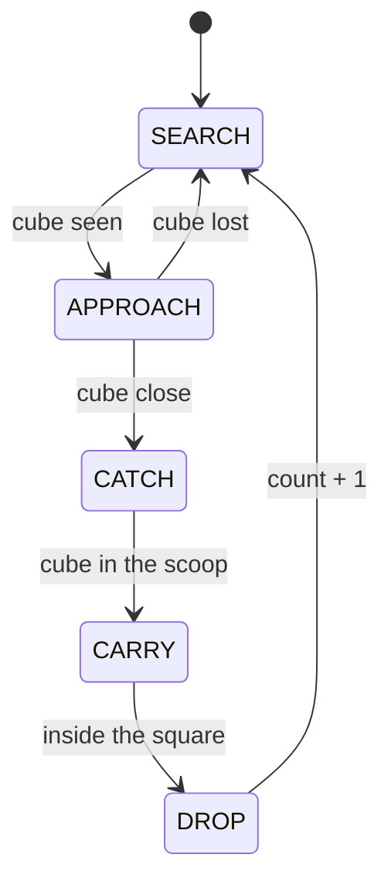

# Collector architecture

Initial proposal. Role 3 maintains it; if you change a topic or a message, change it here in the same PR.

## Layers

```
Raspberry Pi 5 → Cokoino HAT (2× DRV8833) → Ubuntu 24.04 → ROS 2 Jazzy → Python nodes
```

## Nodes



In simulation, `webots_bridge` (package `recolector_sim`) replaces `camera_node`,
`ultrasonic` and `motor_driver`: it publishes `image_raw` and `range` and listens to `cmd_vel`, so the
rest of the nodes are the same as on the real robot.

| Package | Node | What it does | Owner |
|---|---|---|---|
| `mobile_base` | `motor_driver` | `cmd_vel` → PWM for the 4 motors; brakes when no commands arrive | role 1 |
| `mobile_base` | `line_sensors` | 1 bottom TCRT5000 → `line` | role 1 |
| `mobile_base` | `ultrasonic` | HC-SR04 → `range` | role 1 |
| `mobile_base` | `scoop_driver` | scoop servo + presence IR | role 1 |
| `mobile_base` | `color_sensor` | TCS34725 → colour of the cube in the scoop | role 2 |
| `mobile_base` | `obstacle_guard` | limits speed according to distance | role 3 |
| `mobile_base` | `behavior_fsm` | state machine and counting | role 3 |
| `vision` | `camera_node` | camera → `image_raw` | role 2 |
| `vision` | `cube_detector` | cubes by colour → `cubes` and `cubes/debug_image` | role 2 |
| `vision` | `web_viewer` | web page (port 8080): video, cubes, state; changes `behavior_fsm` parameters; manual control with WASD | role 2 |
| `recolector_sim` | `webots_bridge` | simulation only: Webots ↔ `image_raw`, `range`, `cmd_vel` | role 4 |

## Topics (proposal)

| Topic | Type | From → to |
|---|---|---|
| `cmd_vel_teleop` | `geometry_msgs/Twist` | `web_viewer` → `behavior_fsm` (WASD; takes priority while it keeps arriving) |
| `cmd_vel_raw` | `geometry_msgs/Twist` | `behavior_fsm` → `obstacle_guard` |
| `cmd_vel` | `geometry_msgs/Twist` | `obstacle_guard` → `motor_driver` |
| `line` | `recolector_interfaces/LineSensors` | `line_sensors` → `behavior_fsm` |
| `range` | `sensor_msgs/Range` | `ultrasonic` → `obstacle_guard`, `behavior_fsm` |
| `scoop/lower` | `std_msgs/Bool` | `behavior_fsm` → `scoop_driver` |
| `scoop/has_cube` | `std_msgs/Bool` | `scoop_driver` → `behavior_fsm` |
| `scoop/color` | `std_msgs/String` | `color_sensor` → `behavior_fsm` |
| `image_raw` | `sensor_msgs/Image` | `camera_node` → `cube_detector` |
| `cubes` | `recolector_interfaces/CubeDetectionArray` | `cube_detector` → `behavior_fsm`, `web_viewer` |
| `cubes/debug_image` | `sensor_msgs/Image` | `cube_detector` → `web_viewer` (image with the cube boxes) |
| `behavior/state` | `std_msgs/String` (JSON) | `behavior_fsm` → `web_viewer` (state, target and command) |
| `count` | `std_msgs/UInt32` | `behavior_fsm` → anyone who wants it |

## Messages

`CubeDetection`: `color`, `bearing_rad` (positive = left), `distance_m` (along the floor,
from the camera to the bottom edge of the cube), `u`, `v`, `width_px`, `height_px`.
`CubeDetectionArray`: the image `header` and `cubes[]`, from nearest to farthest.

The distance comes from the cube's row in the image, using the camera's height and tilt
(`camera.*` in `vision/config/hsv_ranges.yaml`).

## State machine (proposal)

**Implemented so far** (`mobile_base/approach.py`): `SEARCH` (turns) → `APPROACH` →
`ARRIVED` (stops at `stop_distance_m` from the nearest cube of `target_colors`). Plus
`PAUSED` when `enabled` is false and `NO_CAMERA` if no detections arrive. The scoop is still missing.
`MANUAL` while `cmd_vel_teleop` keeps arriving (WASD in the web viewer): it takes priority over everything
else, even when paused, and still goes through `obstacle_guard`.



In any state: if a line sensor sees black outside the square, the robot backs up and turns; if the ultrasonic sensor sees something close, it brakes.

## Localization

There are no encoders and no SLAM. The robot orients itself with the camera (cubes and square), the bottom line sensor and, if added, the IMU.
