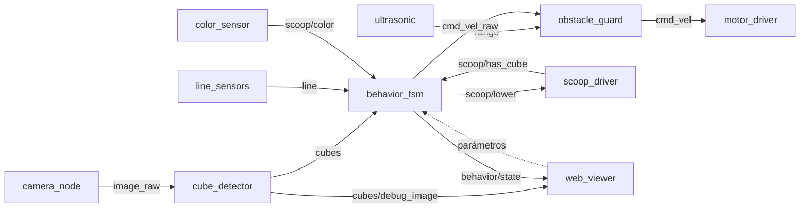
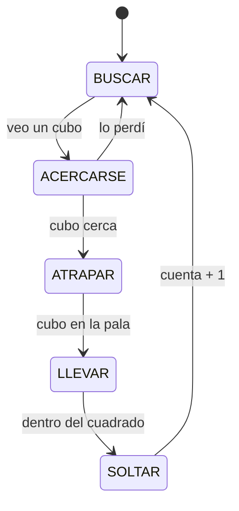

# Arquitectura del recolector

Propuesta inicial. El rol 3 la mantiene; si cambias un tópico o un mensaje, cámbialo aquí en el mismo PR.

## Capas

```
Raspberry Pi 5 → HAT Cokoino (2× DRV8833) → Ubuntu 24.04 → ROS 2 Jazzy → nodos Python
```

## Nodos



En la simulación, `webots_bridge` (paquete `recolector_sim`) reemplaza a `camera_node`,
`ultrasonic` y `motor_driver`: publica `image_raw` y `range` y escucha `cmd_vel`, así el resto
de los nodos es el mismo que en el robot real.

| Paquete | Nodo | Qué hace | Dueño |
|---|---|---|---|
| `mobile_base` | `motor_driver` | `cmd_vel` → PWM de los 4 motores; frena sin comandos | rol 1 |
| `mobile_base` | `line_sensors` | 4 TCRT5000 → `line` | rol 1 |
| `mobile_base` | `ultrasonic` | HC-SR04 → `range` | rol 1 |
| `mobile_base` | `scoop_driver` | servo de la pala + IR de presencia | rol 1 |
| `mobile_base` | `color_sensor` | TCS34725 → color del cubo en la pala | rol 2 |
| `mobile_base` | `obstacle_guard` | limita la velocidad según la distancia | rol 3 |
| `mobile_base` | `behavior_fsm` | máquina de estados y conteo | rol 3 |
| `vision` | `camera_node` | cámara → `image_raw` | rol 2 |
| `vision` | `cube_detector` | cubos por color → `cubes` y `cubes/debug_image` | rol 2 |
| `vision` | `web_viewer` | página web (puerto 8080): video, cubos, estado; cambia parámetros de `behavior_fsm` | rol 2 |
| `recolector_sim` | `webots_bridge` | solo simulación: Webots ↔ `image_raw`, `range`, `cmd_vel` | rol 4 |

## Tópicos (propuesta)

| Tópico | Tipo | De → a |
|---|---|---|
| `cmd_vel_raw` | `geometry_msgs/Twist` | `behavior_fsm` → `obstacle_guard` |
| `cmd_vel` | `geometry_msgs/Twist` | `obstacle_guard` → `motor_driver` |
| `line` | `recolector_interfaces/LineSensors` | `line_sensors` → `behavior_fsm` |
| `range` | `sensor_msgs/Range` | `ultrasonic` → `obstacle_guard`, `behavior_fsm` |
| `scoop/lower` | `std_msgs/Bool` | `behavior_fsm` → `scoop_driver` |
| `scoop/has_cube` | `std_msgs/Bool` | `scoop_driver` → `behavior_fsm` |
| `scoop/color` | `std_msgs/String` | `color_sensor` → `behavior_fsm` |
| `image_raw` | `sensor_msgs/Image` | `camera_node` → `cube_detector` |
| `cubes` | `recolector_interfaces/CubeDetectionArray` | `cube_detector` → `behavior_fsm`, `web_viewer` |
| `cubes/debug_image` | `sensor_msgs/Image` | `cube_detector` → `web_viewer` (imagen con las cajas de los cubos) |
| `behavior/state` | `std_msgs/String` (JSON) | `behavior_fsm` → `web_viewer` (estado, objetivo y comando) |
| `count` | `std_msgs/UInt32` | `behavior_fsm` → quien quiera verlo |

## Mensajes

`CubeDetection`: `color`, `bearing_rad` (positivo = izquierda), `distance_m` (sobre el piso,
desde la cámara hasta el borde de abajo del cubo), `u`, `v`, `width_px`, `height_px`.
`CubeDetectionArray`: `header` de la imagen y `cubes[]`, del más cercano al más lejano.

La distancia sale de la fila del cubo en la imagen, con la altura e inclinación de la cámara
(`camera.*` en `vision/config/hsv_ranges.yaml`).

## Máquina de estados (propuesta)

**Implementado por ahora** (`mobile_base/approach.py`): `BUSCAR` (gira) → `ACERCARSE` →
`LLEGUE` (se detiene a `stop_distance_m` del cubo más cercano de `target_colors`). Más
`PAUSA` cuando `enabled` es falso y `SIN_CAMARA` si no llegan detecciones. Falta la pala.



En cualquier estado: si un sensor de línea ve negro fuera del cuadrado, el robot retrocede y gira; si el ultrasonido ve algo cerca, frena.

## Localización

No hay encoders ni SLAM. El robot se orienta con la cámara (cubos y cuadrado), los 4 sensores de línea y, si se agrega, la IMU.
