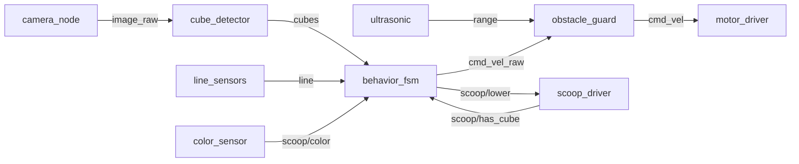
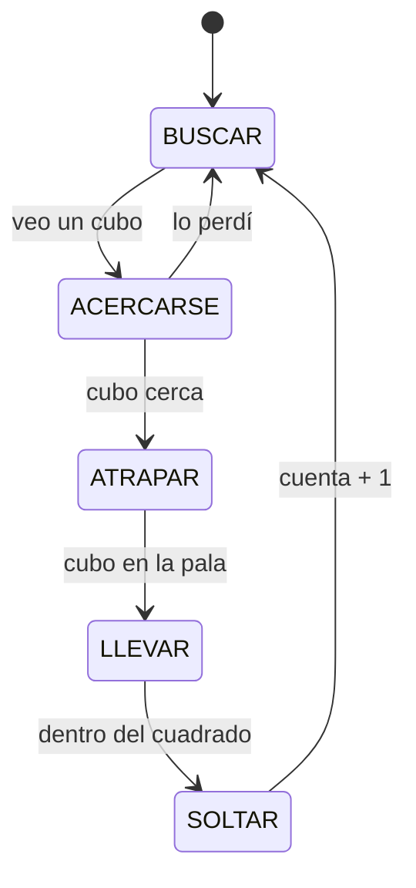

# Arquitectura del recolector

Propuesta inicial. El rol 3 la mantiene; si cambias un tópico o un mensaje, cámbialo aquí en el mismo PR.

## Capas

```
Raspberry Pi 5 → HAT Cokoino (2× DRV8833) → Ubuntu 24.04 → ROS 2 Jazzy → nodos Python
```

## Nodos



| Paquete | Nodo | Qué hace | Dueño |
|---|---|---|---|
| `mobile_base` | `motor_driver` | `cmd_vel` → PWM de los 4 motores; frena sin comandos | rol 1 |
| `mobile_base` | `line_sensors` | 4 TCRT5000 → `line` | rol 1 |
| `mobile_base` | `ultrasonic` | HC-SR04 → `range` | rol 1 |
| `mobile_base` | `scoop_driver` | servo de la pala + IR de presencia | rol 1 |
| `mobile_base` | `color_sensor` | TCS34725 → color del cubo en la pala | rol 2 |
| `mobile_base` | `obstacle_guard` | limita la velocidad según la distancia | rol 3 |
| `mobile_base` | `behavior_fsm` | máquina de estados y conteo | rol 3 |
| `vision` | `camera_node` | cámara → `image_raw` | rol 2 |
| `vision` | `cube_detector` | cubos por color → `cubes` | rol 2 |

## Tópicos (propuesta)

| Tópico | Tipo | De → a |
|---|---|---|
| `cmd_vel_raw` | `geometry_msgs/Twist` | `behavior_fsm` → `obstacle_guard` |
| `cmd_vel` | `geometry_msgs/Twist` | `obstacle_guard` → `motor_driver` |
| `line` | `recolector_interfaces/LineSensors` | `line_sensors` → `behavior_fsm` |
| `range` | `sensor_msgs/Range` | `ultrasonic` → `obstacle_guard`, `behavior_fsm` |
| `scoop/lower` | `std_msgs/Bool` | `behavior_fsm` → `scoop_driver` |
| `scoop/has_cube` | `std_msgs/Bool` | `scoop_driver` → `behavior_fsm` |
| `scoop/color` | `std_msgs/String` | `color_sensor` → `behavior_fsm` |
| `image_raw` | `sensor_msgs/Image` | `camera_node` → `cube_detector` |
| `cubes` | `recolector_interfaces/CubeDetectionArray` | `cube_detector` → `behavior_fsm` |
| `count` | `std_msgs/UInt32` | `behavior_fsm` → quien quiera verlo |

## Máquina de estados (propuesta)



En cualquier estado: si un sensor de línea ve negro fuera del cuadrado, el robot retrocede y gira; si el ultrasonido ve algo cerca, frena.

## Localización

No hay encoders ni SLAM. El robot se orienta con la cámara (cubos y cuadrado), los 4 sensores de línea y, si se agrega, la IMU.
