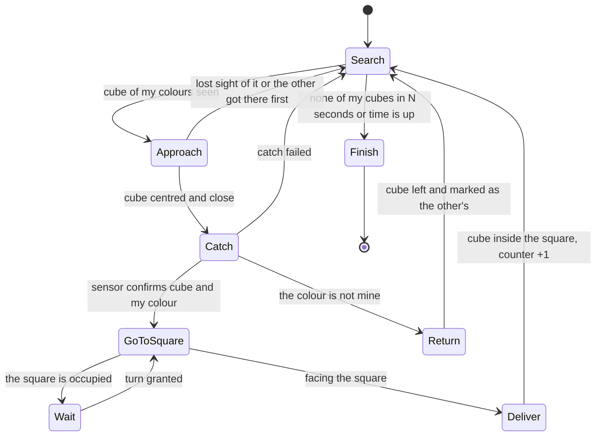
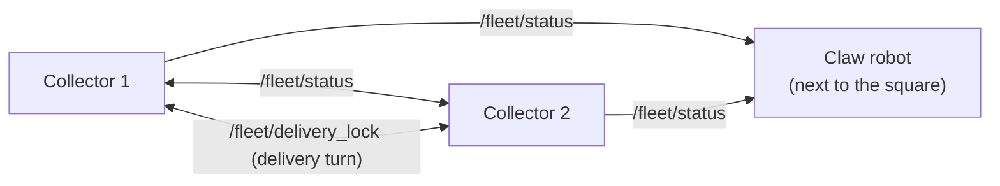

# Cube collector robot — Full plan

**Project:** UCAB Robotics · Multi-robot system (2 collectors + 1 claw robot)
**Plan author:** Samuel (with help from Claude)
**Date:** 27/09/2026 · updated 04/10/2026
**Status:** planning only, there is no code yet.
**Web version:** https://claude.ai/artifact/PfiLGZ2g3D7FJgjf77hLHn

> Everything marked "estimated" comes from the photos and has to be measured.

---

## 0. Summary

- There are three robots. Two collectors pick up the cubes inside the area bounded by the black line and **push or carry them to the black square** on the track. There is no delivery box. The claw robot takes the cubes from the square and sorts them by colour.
- Both collectors carry **the same scoop** and move one cube at a time.
- **Each collector only picks up its reserved colours.** Proposal: Phineas picks up the warm ones (red, orange, yellow) and Ferb the cool ones (green, blue, purple). The claw keeps sorting from the square.
- Both collectors share the same area, so the plan includes rules so they neither crash into nor sabotage each other.
- The idea is to **spend as little as possible**. The network uses a teammate's phone hotspot.
- Software stack agreed in class: Raspberry Pi 5 → HAT → operating system → ROS 2 → application.

**Pending:**
1. Confirm the colour split between Phineas and Ferb with the group.
2. Check with the real cubes that maroon can be told apart from red.
3. Settle the claw's box rule with the professor.

---

## 1. What the photos show

### Track
- White board of about 2.4 × 1.2 m (estimated), with a closed outline of black tape about 2–3 cm wide.
- The work area is the inside of the outline. It has a zigzag on the left, a U-shaped bay at the top and curves at the bottom.
- **Black square** attached to the line on the right side, about 25–30 cm (estimated). It is the **delivery zone**: the collectors leave the cubes inside and the claw robot takes them from there.
- **Cubes:** about 14, wooden, about 2.5 cm (estimated). They come in 6 colours: red, orange, yellow, green, blue and purple or maroon. They are spread over the left half and the centre.
- Inside the area there is a **paper sign** that says "No colocar nada…" ("Do not place anything…"). Its black letters could confuse the line sensors if it is still there on test day.

### Available hardware
| Part | Detail |
|---|---|
| Chassis | LewanSoul / Hiwonder aluminium mecanum, 186 × 161 × 91 mm. It has 4 mecanum wheels of 65 mm and 4 TT 1:120 motors of 3–6 V. Supports ≈1.5 kg of load. **No encoders**: the motors only have 2 wires. The kit includes a front extension bracket. Two chassis are already assembled. |
| Control | Raspberry Pi 5, 8 GB. |
| Driver | Cokoino 4WD HAT with 2 DRV8833 chips, one channel per motor. It has a switch, DC jack, battery terminal block and a regulator that powers the Pi. The manufacturer sells it for Pi 4 and earlier. |

### Class whiteboard
- Layer stack: R.Pi 5 → HAT → operating system → ROS 2 → application. Sensors go in and actuators come out.
- In the drawing of the area, two collectors with a V-shaped front (marked "Ph" and "F", i.e. Phineas and Ferb) carry the cubes to the delivery zone. The claw robot (Perry) distributes them into 3 numbered boxes.

---

## 2. Colour split and delivery to the square

The two collectors are identical: same chassis, same electronics and **the same scoop**. The only difference is which cubes each one looks for. Each robot has **reserved colours** and only pushes those into the black square. The claw robot keeps sorting from the square.

### Proposed split: warm and cool

| Robot | Reserved colours | HSV hue (OpenCV, 0–179) |
|---|---|---|
| Phineas (collector 1) | red, orange, yellow | ≈ 0–35 and 170–179 |
| Ferb (collector 2) | green, blue, purple | ≈ 40–165 |

- **Why this way:** each robot only has to separate "my colours" from "the other's", not recognize 6 colours. Between warm and cool a single cut in HSV hue is enough. If a robot confuses red with orange it does not matter, because both colours are its own.
- **Risk:** dark purple or maroon has a hue close to red. It is separated by saturation and brightness, but it has to be calibrated with the real cubes and the classroom lighting. If that does not work, maroon goes to Phineas and Ferb gets another colour, so it stays 3 and 3.
- If the group prefers a different split (for example, according to the claw's boxes), only this table changes; the rest of the plan stays the same.

### How each robot knows which colours are its own
1. **Configuration file:** each robot loads its colour list and HSV ranges from a YAML file (`phineas.yaml`, `ferb.yaml`). Both robots run the same code.
2. **Announcement at startup:** each robot publishes its colours in the `reserved_colors` field of `/fleet/status`. The claw checks that the two splits do not overlap and that together they cover all 6 colours. If it finds an error, it warns before starting.
3. **Handover:** if a collector stops sending its heartbeat for more than 10 s (it ran out of battery or switched off), the other collector takes over its colours (it sees them in the last `/fleet/status`), and starts collecting all of them. If the missing one comes back, each recovers its own split.

### The scoop (same on both robots)
- Scoop at the front with a U-shaped gap one cube wide (≈3 cm), so the cube does not slip out the sides when turning.
- A servo raises and lowers the scoop. Down, it pushes the cube; up, it releases it inside the square and lets the robot back up without dragging it.
- The mecanum wheels allow sideways corrections without turning. That helps to keep the cube and to go around cubes that are not its own.

### Confirming the colour before delivering
From a distance, the camera can be fooled by the lighting. So, when the cube enters the scoop, a TCS34725 colour sensor (≈3 USD) looks at it up close with its own light. If the colour is not its own, the robot raises the scoop, backs up, leaves the cube where it was and marks it as "the other's".

### The square touches the black line
To deliver, the robot has to get close to the square or enter it slightly. So the "do not cross the line" rule is relaxed only when the robot is facing the square. It recognizes this by an ArUco marker placed next to it, if the rules allow it.

### Counting
The counter goes up when the cube is **inside the square**, not when it is captured. Each robot counts per colour and the claw adds up the total.

---

## 3. Sensors and behaviour

| Need | Proposed sensor (cheap) | What for |
|---|---|---|
| Find cubes of my colours | 5 MP OV5647 Pi camera, or a USB webcam you already have | Looks for colour blobs on the white background and keeps only those that fall within its HSV ranges. |
| Stay inside the area | 4 TCRT5000 line sensors, one per corner | On detecting black, the robot brakes and moves away. |
| Not crash into the other collector | Front HC-SR04 ultrasonic, with a voltage divider on the ECHO pin | Measures the distance to whatever is in front. |
| Know it has a cube | FC-51 IR obstacle module in the scoop | Indicates whether there is a cube and feeds the counter. |
| Confirm the colour of the captured cube | TCS34725 colour sensor inside the scoop | Reads the colour up close with its own light, so it does not deliver a cube that is not its own. |
| Know which way it is facing | MPU6050 IMU | Without encoders, the turn measured by the IMU is the best reference to orient itself and return to the square. |
| Find the square and the other robot | Paper-printed ArUco markers (free) | One goes next to the square and one on top of each robot. The camera computes distance and angle, and recognizes its teammate. |

### Collector state machine

Two rules override everything else, in any state:
1. If a line sensor sees black, the robot stops, backs up and turns inwards. The exception is when it is facing the square.
2. If the ultrasonic sensor detects something close, the robot applies the distance rules from section 4.

---

## 4. Communication and coexistence between the three robots

### Base software
All three Pi 5 run Ubuntu 24.04 with ROS 2 Jazzy. If they are on the same Wi‑Fi network and use the same `ROS_DOMAIN_ID`, each robot's nodes find each other without a central server.

### Free network: phone hotspot
- The three robots connect to a teammate's phone hotspot. Traffic between robots is local and uses almost no data.
- **Risk:** some phones isolate connected devices or block multicast. In that case ROS 2 does not find the other robots. **This must be tested on day one.**
- If it fails, there are three plan Bs:
  1. Give each robot the list of the others' IPs with `ROS_STATIC_PEERS` (available in Jazzy), with fixed IPs.
  2. Use Zenoh as the ROS 2 communication layer.
  3. Have the claw robot's Pi create its own Wi‑Fi network (access point mode) and have the collectors connect to it. It costs nothing and does not depend on the phone's battery.

### Diagram

### Messages (draft to agree with the other teams)

**Proposal, pending agreement with the other collector team.** Each robot runs under its own namespace (`/phineas/...`, `/ferb/...`) and only `/fleet/*` is shared. Transport: both robots on the same Wi‑Fi with the same `ROS_DOMAIN_ID`, and `ROS_STATIC_PEERS=<other robot's IP>` if the network blocks multicast. Bluetooth was ruled out.

| Message | Published by | Content | Rate |
|---|---|---|---|
| `/fleet/status` (`FleetStatus`) | All three | `robot_name`, `state` (SEARCH, APPROACH, CATCH, CARRY, DROP), `has_cube`, `delivered_count`, `reserved_colors` | 2 Hz (heartbeat) |
| `/fleet/delivery_lock` (`DeliveryLock`) | Collectors | Delivery turn: `robot_name`, `action` (REQUEST / RELEASE), `stamp`. Expires after 30 s if nobody releases it | On each delivery |
| Claw count (name to agree with the claw team) | Claw | Total delivered, total sorted and total per colour. If it does not match the collectors' `delivered_count`, there was a colour error | When it changes |

### Rules to avoid crashing and sabotage
1. **Each cube has an owner by its colour.** A robot never goes for a cube that is not one of its colours, so they never compete for cubes. If one of the other's cubes is in its way, it goes around it sideways (the mecanum wheels allow it) instead of pushing it.
2. **Priority to the loaded robot.** The robot with a cube in its scoop has right of way; the empty one yields and moves aside.
3. **Minimum distance**, with the steps from Ignacio's document:
   - More than 30 cm: normal speed.
   - Between 15 and 30 cm: half speed.
   - Less than 15 cm: full stop.
   - If it stays blocked for more than 5 s, it backs up.

   In a tie the same robot always yields (fixed priority), so they never both end up waiting.
4. **Delivery turn.** Only one robot at a time at the delivery zone. The two collectors share a "lock" on `/fleet/delivery_lock`: the robot sends REQUEST and goes in only if the other one does not hold it, delivers and sends RELEASE on the way out. If it is not released within 30 s, the lock expires on its own. If both request at the same time, the same robot always yields. The waiting robot stays more than 30 cm from the zone so it does not block the entrance.
5. **No sabotage.** No robot moves cubes of the other's colours, removes or pushes cubes already inside the square, or stands still on the way to it. When delivering, it pushes the cube just enough for it to end up inside, without dragging the ones already there.
6. **If the network goes down,** the robot stops in less than 2 s and waits for it to come back. In addition, a person stays next to each robot's master switch.
7. **Counting.** Each collector keeps its own count and the claw adds up the total. If the delivery count and the sorted count do not match, some cube ended up outside the square.

---

## 5. Risks to check before buying

- **Pi 5 power.** The Pi 5 asks for 5 V at 5 A. If the HAT's regulator only gives about 3 A, the Pi boots but limits USB and can reboot when the motors draw current. The cheap option is a 5 A XL4015 regulator (≈3 USD) just for the Pi, connected to the same battery. Before buying it, it is worth reading the part number of the HAT's regulator chip. Ignacio's document also requires a 5 V DC-DC of at least 5 A per robot.
- **Battery voltage.** The DRV8833 handles up to 10.8 V, so the battery has to be **2S** (7.4 V nominal, 8.4 V charged). **A 3S (11.1 V) burns it.** The TT motors are 3–6 V, so with 2S the speed has to be limited in software to ~70 %.
- **Pi 5 pins.** The Pi 5 changed the GPIO chip, and **RPi.GPIO does not work** on it. gpiozero or lgpio must be used, and the Cokoino repository (https://github.com/Cokoino/CKK0018) has to be checked for which pins the HAT uses for each motor. The servo can be driven with the Pi 5's hardware PWM, without buying a separate controller.
- **No encoders and mecanum wheels.** Mecanum wheels slip and, without encoders, the robot does not know where it is. That is why the plan relies on the camera, the IMU and the markers instead of measuring distances.
- **Heat and height.** With ROS 2 and vision, the Pi 5 heats up and needs a heatsink with a fan. The fan collides with the HAT if it is mounted right on top, so a GPIO extender header and taller standoffs are needed.
- **HAT unverified on the Pi 5.** A half-day test is needed: if a motor turns from the Pi 5, the HAT works. If it fails, another driver has to be ordered immediately.

---

## 6. Scoop: models to print

Both collectors carry the same scoop, so the same model is printed twice. I did not find a scoop made for this chassis. The realistic option is to take a scoop for an SG90 servo and attach it with a bracket to the Hiwonder kit's front bracket. **Check the dimensions when downloading**, because I could not open the Thingiverse pages. The U has to let a ≈2.5 cm cube through with clearance and leave room for the colour sensor.

| Model | What it is | Why it works |
|---|---|---|
| [Snow Plow for FPV Rover (Markus_p)](https://www.printables.com/model/43963-snow-plow-for-fpv-rover) | Push blade for a small rover, with base, servo mount and pivot | It is exactly the mechanism needed. The base has to be adapted to the chassis and a cube-wide U added. |
| [Bulldozer Blade (WYseman76)](https://www.thingiverse.com/thing:3738234) | Bulldozer blade | Alternative if the previous one is too big; it also needs the U added. |
| [Mini Track Loader RC (raab6)](https://www.thingiverse.com/thing:2522648) | Front loader with bucket and SG90 servo | Useful if the push blade loses cubes in curves, because the bucket holds them better. |
| [SG90 servo holder (jhaand)](https://www.printables.com/model/223148-sg90-servo-holder) or [SG90 Bracket and Arm (klopex)](https://www.thingiverse.com/thing:3834853) | SG90 servo mount | Attaches the servo to the front bracket with M3 screws. |

Before printing, measure the height of the front bracket above the table and the spacing of its holes. The scoop has to sit 2–3 mm above the board.

---

## 7. Parts to get (low cost)

Prices are approximate, in USD, from AliExpress or local shops. If someone on the team already has a part, it is reused.

| Part | Qty | What for | ≈ USD | Priority |
|---|---|---|---|---|
| OV5647 5 MP Pi camera (or a USB webcam you already have) | 1 | See cubes and markers | 6–10 | Required |
| Pi 5 camera cable (22 to 15 pins) | 1 | The Pi 5 has a smaller camera connector (not needed if you use a USB webcam) | 1–3 | Required |
| TCRT5000 line sensor module | 4 | Do not cross the black line | 0.5 each | Required |
| HC-SR04 ultrasonic, with voltage divider on ECHO | 1 | Do not crash into the other collector | 1 | Required |
| FC-51 IR obstacle module | 1 | Detect the cube in the scoop and count it | 0.5 | Required |
| TCS34725 colour sensor (I²C, with its own LED) | 1 | Confirm the colour of the cube inside the scoop | 2–4 | Required |
| MPU6050 IMU | 1 | Orient itself without encoders | 2 | Required |
| SG90 servo (or MG90S if the scoop is heavy) | 1 | Raise and lower the scoop | 2–4 | Required |
| Branded 18650 batteries (avoid generic "9900 mAh" ones) | 2 | 2S battery for motors and Pi | 3–6 each | Required |
| 2S battery holder + 2S BMS module | 1 | Protect the batteries from over-discharge | 2–3 | Required |
| Fuse with fuse holder + master switch | 1 | Safety (required by Ignacio's document) | 1–2 | Required |
| 5 A XL4015 regulator | 1 | Power the Pi 5 separately | 2–3 | Required |
| Heatsink with 5 V fan for Pi 5 | 1 | Keep the Pi from throttling due to heat | 2–4 | Required |
| 40-pin GPIO extender + M2.5 standoffs | 1 set | Mount the HAT above the fan | 2–3 | Required |
| 32–64 GB microSD | 1 | Operating system and ROS 2 | 5–8 | Required |
| 3D print of the scoop and bracket (PLA) | — | See section 6 | 2–5 | Required |
| Female-female dupont wires and M3 screws | 1 kit | Wiring and assembly | 3 | Required |
| 18650 charger | 1 for the team | Charge the batteries | 4–8 | Optional |
| Battery voltage alarm | 1 | Warn before the battery runs out | 1 | Optional |
| TT motors with encoder | 4 | Measure distance travelled | 4–6 each | Optional |

**Approximate total for the required parts: 40–70 USD per robot.** Less if you reuse the camera or the microSD. The network costs nothing if you use the hotspot or the claw's Pi as an access point.

---

## 8. Suggested work order

1. Measure the track, the black square, the cubes and the chassis front bracket. Confirm the rules: time, Wi‑Fi use and whether markers are allowed.
2. Agree with the other two teams on the colour split, the message table and the crossing rules.
3. Test the network: the three Pis connected to the phone hotspot and seeing each other over ROS 2.
4. Sort out power: 2S battery, regulator for the Pi and a motor test with the HAT on the Pi 5.
5. Mount the line sensors and the ultrasonic, and get the robot moving without leaving the area or crashing.
6. Calibrate the HSV ranges with the real cubes and the classroom lighting, separate "my colours" from the other's and detect the markers.
7. Download, adjust and print the scoop (two copies) and mount it with its servo and the colour sensor.
8. Find the square, deliver the cube inside and count.
9. Run a test with both collectors and the claw together.

---

## 9. Comparison with Ignacio's documents

Ignacio wrote two documents, dated 22/09/2026: *"Sistema Multirobot Colaborativo — Documento Inicial"* (Collaborative Multi-Robot System — Initial Document) and *"Tecnología, Código y To-Do de Laboratorio"* (Technology, Code and Lab To-Do). In those documents the mobile robots are called **Phineas** and **Ferb**, and the fixed arm is called **Perry**. Perry has a Pololu Maestro controller, MG996R servos and an overhead camera.

### Agreements
Both plans use the Pi 5, the Cokoino HAT with DRV8833, the Hiwonder mecanum chassis and ROS 2. In both, the mobile robots push the cubes to the delivery zone, an arm sorts by colour and each robot keeps a cube counter. Unlike Ignacio's documents, where the mobile robots do not know the colours, now each mobile robot only picks up its reserved colours.

### What we adopted from his documents (already in this plan)
- The delivery-zone "lock", which expires after 60 s.
- The ultrasonic distance steps (30 cm and 15 cm, and back up after 5 s) with fixed priority between the mobile robots.
- Stopping in less than 2 s if the network is lost, plus a person next to the switch.
- Using lgpio or gpiozero instead of RPi.GPIO.
- A fuse and a master switch per battery.

### Useful for the whole group
- His requirements RF-01 to RF-22, each with its test criterion. The non-negotiable ones are RF-04, 07, 13 and 19.
- The `ucab-multirobot` monorepo, with fake nodes for testing without the robots and all parameters in YAML files.
- Lab sessions S1–S4 and their checklists.
- Vision in phases: HSV only first, and YOLO only if needed and there is time.

### Differences to decide with the group
1. **Network.** Ignacio asks for a dedicated router and we use the phone hotspot. The multicast risk applies equally in both cases. The recommendation is to try the hotspot first and buy the router only if it fails.
2. **Overhead camera.** Ignacio proposes a webcam above the whole track to locate cubes and robots. It solves the lack of encoders well, but adds the cost of a webcam and a tall mount.
3. **Colour rule.** Ignacio proposes that the claw start with light/dark in 2 containers, but the track has 6 colours and the whiteboard shows 3 boxes. We need to ask the professor. If the claw ends up using colour groups, the split between Phineas and Ferb should follow those same groups.
