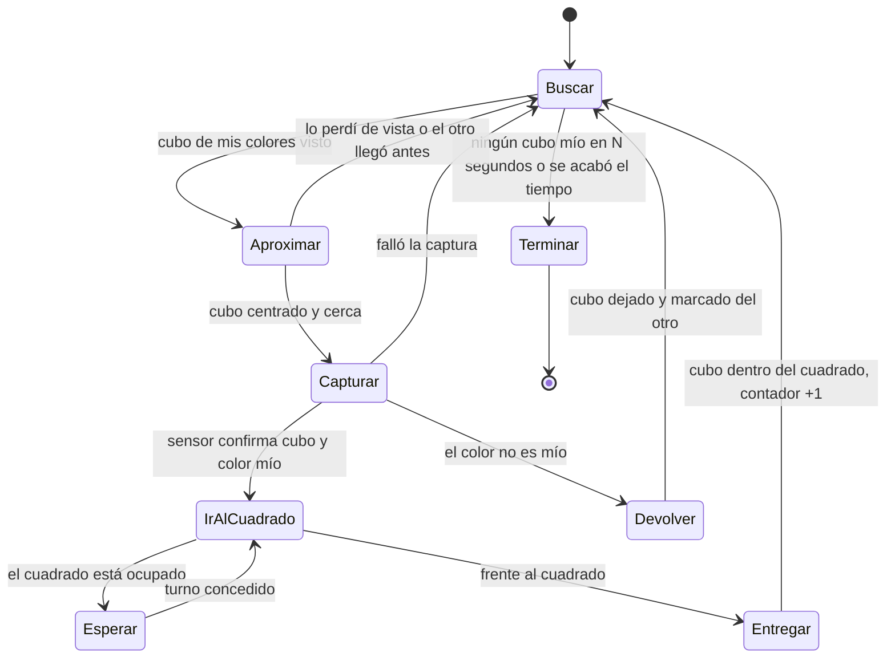
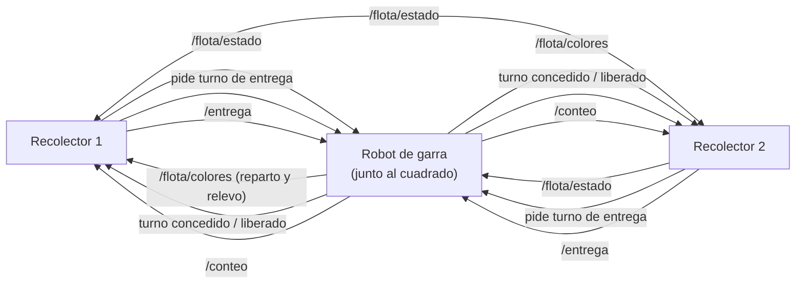

# Robot recolector de cubos — Plan completo

**Proyecto:** UCAB Robótica · Sistema multirobot (2 recolectores + 1 robot de garra)
**Autor del plan:** Samuel (con apoyo de Claude)
**Fecha:** 27/09/2026 · actualizado 04/10/2026
**Estado:** solo planificación, todavía no hay código.
**Versión web:** https://claude.ai/artifact/PfiLGZ2g3D7FJgjf77hLHn

> Todo lo que aparece como "estimado" sale de las fotos y hay que medirlo.

---

## 0. Resumen

- Hay tres robots. Dos recolectores recogen los cubos dentro del área delimitada por la línea negra y los **empujan o llevan hasta el cuadrado negro** de la pista. No hay caja de entrega. El robot de garra toma los cubos del cuadrado y los clasifica por color.
- Los dos recolectores llevan **la misma pala** y mueven un cubo a la vez.
- **Cada recolector recoge solo sus colores reservados.** Propuesta: Phineas recoge los cálidos (rojo, naranja, amarillo) y Ferb los fríos (verde, azul, morado). La garra sigue clasificando desde el cuadrado.
- Los dos recolectores comparten la misma área, así que el plan incluye reglas para que no choquen ni se saboteen.
- La idea es **gastar lo menos posible**. La red usa el hotspot del celular de un compañero.
- Pila de software acordada en clase: Raspberry Pi 5 → HAT → sistema operativo → ROS 2 → aplicación.

**Pendientes:**
1. Confirmar con el grupo el reparto de colores entre Phineas y Ferb.
2. Comprobar con los cubos reales que el vinotinto se distingue del rojo.
3. Definir con el profesor la regla de cajas de la garra.

---

## 1. Lo que muestran las fotos

### Pista
- Tablero blanco de unos 2,4 × 1,2 m (estimado), con un contorno cerrado de cinta negra de unos 2–3 cm de ancho.
- El área de trabajo es el interior del contorno. Tiene un zigzag a la izquierda, una bahía en U arriba y curvas abajo.
- **Cuadrado negro** unido a la línea en el lado derecho, de unos 25–30 cm (estimado). Es la **zona de entrega**: los recolectores dejan los cubos adentro y el robot de garra los toma de ahí.
- **Cubos:** unos 14, de madera, de unos 2,5 cm (estimado). Vienen en 6 colores: rojo, naranja, amarillo, verde, azul y morado o vinotinto. Están repartidos por la mitad izquierda y el centro.
- Dentro del área hay un **cartel de papel** que dice "No colocar nada…". Sus letras negras pueden confundir a los sensores de línea si sigue ahí el día de la prueba.

### Hardware disponible
| Pieza | Detalle |
|---|---|
| Chasis | LewanSoul / Hiwonder mecanum de aluminio, 186 × 161 × 91 mm. Tiene 4 ruedas mecanum de 65 mm y 4 motores TT 1:120 de 3–6 V. Aguanta ≈1,5 kg de carga. **Sin encoders**: los motores solo tienen 2 cables. El kit trae un soporte de extensión delantero. Ya hay dos chasis armados. |
| Control | Raspberry Pi 5 de 8 GB. |
| Driver | HAT Cokoino 4WD con 2 chips DRV8833, un canal por motor. Trae interruptor, jack DC, bornera de batería y un regulador que alimenta la Pi. El fabricante lo vende para Pi 4 y anteriores. |

### Pizarra de clase
- Pila de capas: R.Pi 5 → HAT → sistema operativo → ROS 2 → aplicación. Los sensores entran y los actuadores salen.
- En el dibujo del área, dos recolectores con el frente en V (marcados "Ph" y "F", es decir, Phineas y Ferb) llevan los cubos a la zona de entrega. El robot de garra (Perry) los reparte en 3 cajas numeradas.

---

## 2. Reparto de colores y entrega al cuadrado

Los dos recolectores son iguales: mismo chasis, misma electrónica y **la misma pala**. Lo único que cambia es qué cubos busca cada uno. Cada robot tiene **colores reservados** y solo empuja esos al cuadrado negro. El robot de garra sigue clasificando desde el cuadrado.

### Propuesta de reparto: cálidos y fríos

| Robot | Colores reservados | Tono en HSV (OpenCV, 0–179) |
|---|---|---|
| Phineas (recolector 1) | rojo, naranja, amarillo | ≈ 0–35 y 170–179 |
| Ferb (recolector 2) | verde, azul, morado | ≈ 40–165 |

- **Por qué así:** cada robot solo tiene que separar "mis colores" de "los del otro", no reconocer 6 colores. Entre cálidos y fríos basta un corte en el tono HSV. Si un robot confunde rojo con naranja no pasa nada, porque los dos colores son suyos.
- **Riesgo:** el morado oscuro o vinotinto tiene un tono parecido al rojo. Se separa por saturación y brillo, pero hay que calibrarlo con los cubos reales y la luz del salón. Si no se logra, el vinotinto pasa a Phineas y Ferb recibe otro color, para que queden 3 y 3.
- Si el grupo prefiere otro reparto (por ejemplo, según las cajas de la garra), solo cambia esta tabla; el resto del plan queda igual.

### Cómo sabe cada robot qué colores le tocan
1. **Archivo de configuración:** cada robot carga su lista de colores y sus rangos HSV desde un archivo YAML (`phineas.yaml`, `ferb.yaml`). Los dos robots corren el mismo código.
2. **Anuncio al arrancar:** cada robot publica sus colores en `/flota/colores`. La garra revisa que los dos repartos no se repitan y que entre los dos cubran los 6 colores. Si encuentra un error, avisa antes de empezar.
3. **Relevo:** si un recolector deja de enviar su latido por más de 10 s (se quedó sin batería o se apagó), la garra le pasa sus colores al otro por `/flota/colores`, y este empieza a recogerlos todos. Si el que faltaba vuelve, cada uno recupera su reparto.

### La pala (igual en los dos robots)
- Pala al frente con un hueco en U del ancho de un cubo (≈3 cm), para que el cubo no se escape por los lados al girar.
- Un servo sube y baja la pala. Abajo empuja el cubo; arriba lo suelta dentro del cuadrado y deja retroceder sin arrastrarlo.
- Las ruedas mecanum permiten corregir de lado sin girar. Eso ayuda a no perder el cubo y a rodear los cubos que no le tocan.

### Confirmar el color antes de entregar
Desde lejos, la cámara se puede equivocar por la luz. Por eso, cuando el cubo entra en la pala, un sensor de color TCS34725 (≈3 USD) lo mira de cerca con su propia luz. Si el color no es suyo, el robot sube la pala, retrocede, deja el cubo donde estaba y lo marca como "del otro".

### El cuadrado toca la línea negra
Para entregar, el robot tiene que acercarse al cuadrado o entrar un poco en él. Por eso la regla de "no cruzar la línea" se relaja solo cuando el robot está frente al cuadrado. Lo reconoce por un marcador ArUco puesto al lado, si las reglas lo permiten.

### Conteo
El contador sube cuando el cubo queda **dentro del cuadrado**, no cuando se captura. Cada robot cuenta por color y la garra suma el total.

---

## 3. Sensores y comportamiento

| Necesidad | Sensor propuesto (barato) | Para qué |
|---|---|---|
| Encontrar cubos de mis colores | Cámara OV5647 de 5 MP para Pi, o una webcam USB que ya tengan | Busca manchas de color sobre el fondo blanco y se queda solo con las que caen en sus rangos HSV. |
| No salirse del área | 4 sensores de línea TCRT5000, uno por esquina | Al detectar negro, el robot frena y se aleja. |
| No chocar con el otro recolector | Ultrasonido HC-SR04 al frente, con divisor de voltaje en el pin ECHO | Mide la distancia a lo que tenga delante. |
| Saber que tiene un cubo | Módulo IR de obstáculo FC-51 en la pala | Indica si hay cubo y alimenta el contador. |
| Confirmar el color del cubo capturado | Sensor de color TCS34725 dentro de la pala | Lee el color de cerca con su propia luz, para no entregar un cubo que no le toca. |
| Saber hacia dónde mira | IMU MPU6050 | Sin encoders, el giro que mide la IMU es la mejor referencia para orientarse y volver al cuadrado. |
| Encontrar el cuadrado y al otro robot | Marcadores ArUco impresos en papel (gratis) | Uno va junto al cuadrado y otro encima de cada robot. La cámara calcula distancia y ángulo, y reconoce al compañero. |

### Máquina de estados del recolector

Dos reglas mandan sobre todo lo demás, en cualquier estado:
1. Si un sensor de línea ve negro, el robot se detiene, retrocede y gira hacia adentro. La excepción es cuando está frente al cuadrado.
2. Si el ultrasonido detecta algo cerca, el robot aplica las reglas de distancia de la sección 4.

---

## 4. Comunicación y convivencia entre los tres robots

### Software base
Las tres Pi 5 llevan Ubuntu 24.04 con ROS 2 Jazzy. Si están en la misma red Wi‑Fi y usan el mismo `ROS_DOMAIN_ID`, los nodos de cada robot se encuentran entre sí sin necesidad de un servidor central.

### Red sin gastar: hotspot del celular
- Los tres robots se conectan al hotspot del teléfono de un compañero. El tráfico entre robots es local y casi no consume datos.
- **Riesgo:** algunos teléfonos aíslan a los equipos conectados o bloquean el multicast. En ese caso ROS 2 no encuentra a los otros robots. **Hay que probarlo el primer día.**
- Si falla, hay tres planes B:
  1. Darle a cada robot la lista de IPs de los otros con `ROS_STATIC_PEERS` (disponible en Jazzy), con IPs fijas.
  2. Usar Zenoh como capa de comunicación de ROS 2.
  3. Hacer que la Pi del robot de garra cree su propia red Wi‑Fi (modo punto de acceso) y que los recolectores se conecten a ella. No cuesta nada y no depende de la batería del teléfono.

### Diagrama

### Mensajes (borrador para acordar con los otros equipos)

| Mensaje | Quién publica | Contenido | Frecuencia |
|---|---|---|---|
| `/flota/estado` | Los tres | Nombre, estado actual, si lleva cubo, cubos entregados, batería | 2 Hz (latido) |
| `/flota/colores` | Cada recolector al arrancar; la garra en un relevo | Qué colores tiene reservados cada robot | Al arrancar y cuando cambia |
| turno de entrega | El recolector lo pide y la garra responde | Servicio ROS 2: "¿puedo acercarme?" → sí / espera | En cada entrega |
| `/entrega` | Recolectores | Quién entregó, color del cubo y su cuenta acumulada por color | En cada entrega |
| `/conteo` | Garra | Total entregado, total clasificado y total por color. Si no coincide con lo que reportó el recolector, hubo un error de color | Cuando cambia |

### Reglas para no chocar ni sabotearse
1. **Cada cubo tiene dueño por su color.** Un robot nunca va por un cubo que no es de sus colores, así que no se disputan cubos. Si un cubo del otro está en su camino, lo rodea de lado (las ruedas mecanum lo permiten) en vez de empujarlo.
2. **Prioridad al que lleva carga.** El robot que tiene un cubo en la pala tiene paso; el que va vacío cede y se aparta.
3. **Distancia mínima**, con los escalones del documento de Ignacio:
   - Más de 30 cm: velocidad normal.
   - Entre 15 y 30 cm: media velocidad.
   - Menos de 15 cm: alto total.
   - Si sigue bloqueado más de 5 s, retrocede.

   En un empate cede siempre el mismo robot (prioridad fija), así nunca se quedan los dos esperando.
4. **Turno de entrega.** Solo un robot a la vez frente al cuadrado negro. La garra reparte el turno como una "llave": el robot la pide, entra, entrega y la devuelve al salir. Si no la devuelve en 60 s, la llave caduca sola. El robot que espera se queda a más de 30 cm del cuadrado para no tapar la entrada.
5. **Sin sabotaje.** Ningún robot mueve cubos del otro color, ni saca o empuja cubos que ya estén dentro del cuadrado, ni se queda parado en el camino hacia él. Al entregar, empuja el cubo solo lo justo para que quede adentro, sin arrastrar los que ya están.
6. **Si se cae la red,** el robot se detiene en menos de 2 s y espera a que vuelva. Además, una persona se queda junto al interruptor maestro de cada robot.
7. **Conteo.** Cada recolector lleva su propia cuenta y la garra suma el total. Si la cuenta de entregas y la de clasificados no coinciden, algún cubo quedó fuera del cuadrado.

---

## 5. Riesgos a revisar antes de comprar

- **Alimentación de la Pi 5.** La Pi 5 pide 5 V a 5 A. Si el regulador del HAT da solo unos 3 A, la Pi arranca pero limita los USB y puede reiniciarse cuando los motores piden corriente. La opción barata es un regulador XL4015 de 5 A (≈3 USD) solo para la Pi, conectado a la misma batería. Antes de comprarlo, conviene leer el código del chip regulador del HAT. El documento de Ignacio también exige un DC-DC de 5 V y al menos 5 A por robot.
- **Voltaje de la batería.** El DRV8833 aguanta hasta 10,8 V, así que la batería tiene que ser **2S** (7,4 V nominales, 8,4 V cargada). **Una 3S (11,1 V) lo quema.** Los motores TT son de 3–6 V, así que con 2S hay que limitar la velocidad por software a un ~70 %.
- **Pines de la Pi 5.** La Pi 5 cambió el chip de GPIO, y **RPi.GPIO no funciona** en ella. Hay que usar gpiozero o lgpio, y revisar en el repositorio de Cokoino (https://github.com/Cokoino/CKK0018) qué pines usa el HAT para cada motor. El servo se puede manejar con el PWM por hardware de la Pi 5, sin comprar un controlador aparte.
- **Sin encoders y con ruedas mecanum.** Las ruedas mecanum patinan y, sin encoders, el robot no sabe dónde está. Por eso el plan se apoya en la cámara, la IMU y los marcadores en lugar de medir distancias.
- **Calor y altura.** Con ROS 2 y visión, la Pi 5 se calienta y necesita un disipador con ventilador. El ventilador choca con el HAT si este va montado justo encima, así que hacen falta un conector GPIO extensor y separadores más altos.
- **HAT sin verificar en la Pi 5.** Hay que hacer una prueba de medio día: si un motor gira desde la Pi 5, el HAT sirve. Si falla, hay que pedir otro driver de inmediato.

---

## 6. Pala: modelos para imprimir

Los dos recolectores llevan la misma pala, así que se imprime el mismo modelo dos veces. No encontré una pala hecha para este chasis. Lo realista es tomar una pala para servo SG90 y fijarla con un soporte al soporte delantero del kit Hiwonder. **Hay que revisar las medidas al descargar**, porque no pude abrir las páginas de Thingiverse. La U tiene que dejar pasar un cubo de ≈2,5 cm con holgura y dejar sitio para el sensor de color.

| Modelo | Qué es | Por qué sirve |
|---|---|---|
| [Snow Plow for FPV Rover (Markus_p)](https://www.printables.com/model/43963-snow-plow-for-fpv-rover) | Pala de empuje para un rover pequeño, con base, soporte de servo y pivote | Es justo el mecanismo que hace falta. Hay que adaptar la base al chasis y agregarle la U del ancho de un cubo. |
| [Bulldozer Blade (WYseman76)](https://www.thingiverse.com/thing:3738234) | Hoja de bulldozer | Alternativa si la anterior queda grande; también hay que agregarle la U. |
| [Mini Track Loader RC (raab6)](https://www.thingiverse.com/thing:2522648) | Cargador frontal con cuchara y servo SG90 | Sirve si la pala de empuje pierde cubos en las curvas, porque la cuchara los retiene mejor. |
| [SG90 servo holder (jhaand)](https://www.printables.com/model/223148-sg90-servo-holder) o [SG90 Bracket and Arm (klopex)](https://www.thingiverse.com/thing:3834853) | Soporte de servo SG90 | Fija el servo al soporte delantero con tornillos M3. |

Antes de imprimir hay que medir la altura del soporte delantero sobre la mesa y la separación de sus agujeros. La pala tiene que quedar a 2–3 mm del tablero.

---

## 7. Piezas a conseguir (bajo costo)

Los precios son aproximados, en USD, de AliExpress o tiendas locales. Si alguien del equipo ya tiene una pieza, se reutiliza.

| Pieza | Cant. | Para qué | ≈ USD | Prioridad |
|---|---|---|---|---|
| Cámara OV5647 5 MP para Pi (o webcam USB que ya tengan) | 1 | Ver cubos y marcadores | 6–10 | Necesario |
| Cable de cámara para Pi 5 (22 a 15 pines) | 1 | La Pi 5 tiene un conector de cámara más pequeño (no hace falta si usan webcam USB) | 1–3 | Necesario |
| Módulo de sensor de línea TCRT5000 | 4 | No cruzar la línea negra | 0,5 c/u | Necesario |
| Ultrasonido HC-SR04, con divisor de voltaje en ECHO | 1 | No chocar con el otro recolector | 1 | Necesario |
| Módulo IR de obstáculo FC-51 | 1 | Detectar el cubo en la pala y contarlo | 0,5 | Necesario |
| Sensor de color TCS34725 (I²C, con LED propio) | 1 | Confirmar el color del cubo dentro de la pala | 2–4 | Necesario |
| IMU MPU6050 | 1 | Orientarse sin encoders | 2 | Necesario |
| Servo SG90 (o MG90S si la pala pesa) | 1 | Subir y bajar la pala | 2–4 | Necesario |
| Baterías 18650 de marca (evitar las genéricas de "9900 mAh") | 2 | Batería 2S para motores y Pi | 3–6 c/u | Necesario |
| Portapilas 2S + módulo BMS 2S | 1 | Proteger las baterías de la sobredescarga | 2–3 | Necesario |
| Fusible con portafusible + interruptor maestro | 1 | Seguridad (requisito del documento de Ignacio) | 1–2 | Necesario |
| Regulador XL4015 de 5 A | 1 | Alimentar la Pi 5 por separado | 2–3 | Necesario |
| Disipador con ventilador de 5 V para Pi 5 | 1 | Evitar que la Pi baje su velocidad por calor | 2–4 | Necesario |
| Extensor GPIO de 40 pines + separadores M2.5 | 1 juego | Montar el HAT por encima del ventilador | 2–3 | Necesario |
| MicroSD de 32–64 GB | 1 | Sistema operativo y ROS 2 | 5–8 | Necesario |
| Impresión 3D de la pala y el soporte (PLA) | — | Ver sección 6 | 2–5 | Necesario |
| Cables dupont hembra-hembra y tornillos M3 | 1 kit | Cableado y montaje | 3 | Necesario |
| Cargador de 18650 | 1 para el equipo | Cargar las baterías | 4–8 | Opcional |
| Alarma de voltaje de batería | 1 | Avisar antes de que la batería se agote | 1 | Opcional |
| Motores TT con encoder | 4 | Medir la distancia recorrida | 4–6 c/u | Opcional |

**Total aproximado de lo necesario: 40–70 USD por robot.** Sale menos si reutilizan la cámara o la microSD. La red no cuesta nada si usan el hotspot o la Pi de la garra como punto de acceso.

---

## 8. Orden de trabajo sugerido

1. Medir la pista, el cuadrado negro, los cubos y el soporte delantero del chasis. Confirmar las reglas: tiempo, uso de Wi‑Fi y si se permiten marcadores.
2. Acordar con los otros dos equipos el reparto de colores, la tabla de mensajes y las reglas de cruce.
3. Probar la red: las tres Pi conectadas al hotspot del celular y viéndose por ROS 2.
4. Resolver la alimentación: batería 2S, regulador para la Pi y prueba de los motores con el HAT en la Pi 5.
5. Montar los sensores de línea y el ultrasonido, y lograr que el robot se mueva sin salirse ni chocar.
6. Calibrar los rangos HSV con los cubos reales y la luz del salón, separar "mis colores" de los del otro y detectar los marcadores.
7. Descargar, ajustar e imprimir la pala (dos copias) y montarla con su servo y el sensor de color.
8. Encontrar el cuadrado, entregar el cubo adentro y contar.
9. Hacer una prueba con los dos recolectores y la garra juntos.

---

## 9. Comparación con los documentos de Ignacio

Ignacio escribió dos documentos, fechados el 22/09/2026: *"Sistema Multirobot Colaborativo — Documento Inicial"* y *"Tecnología, Código y To-Do de Laboratorio"*. En esos documentos los móviles se llaman **Phineas** y **Ferb**, y el brazo fijo se llama **Perry**. Perry lleva una controladora Pololu Maestro, servos MG996R y una cámara cenital.

### Coincidencias
Los dos planes usan la Pi 5, el HAT Cokoino con DRV8833, el chasis mecanum Hiwonder y ROS 2. En los dos, los móviles empujan los cubos a la zona de entrega, un brazo clasifica por color y cada robot lleva un contador de cubos. A diferencia de los documentos de Ignacio, donde los móviles no conocen los colores, ahora cada móvil recoge solo sus colores reservados.

### Lo que adoptamos de sus documentos (ya está en este plan)
- La "llave" de la zona de entrega, que caduca a los 60 s.
- Los escalones de distancia del ultrasonido (30 cm y 15 cm, y retroceder después de 5 s) con prioridad fija entre los móviles.
- La parada en menos de 2 s si se pierde la red, más una persona junto al interruptor.
- Usar lgpio o gpiozero en lugar de RPi.GPIO.
- Un fusible y un interruptor maestro por batería.

### Lo que sirve para todo el grupo
- Sus requisitos RF-01 a RF-22, cada uno con su criterio de prueba. Los no negociables son RF-04, 07, 13 y 19.
- El monorepo `ucab-multirobot`, con nodos falsos para probar sin los robots y todos los parámetros en archivos YAML.
- Las sesiones de laboratorio S1–S4 y sus checklists.
- La visión por fases: primero solo HSV, y YOLO solo si hace falta y hay tiempo.

### Diferencias por decidir con el grupo
1. **Red.** Ignacio pide un router propio y nosotros usamos el hotspot del celular. El riesgo del multicast aplica igual en los dos casos. La recomendación es probar el hotspot primero y comprar el router solo si falla.
2. **Cámara cenital.** Ignacio propone una webcam sobre toda la pista para ubicar cubos y robots. Resuelve bien la falta de encoders, pero suma el costo de una webcam y un soporte alto.
3. **Regla de color.** Ignacio propone que la garra empiece con claro/oscuro en 2 contenedores, pero la pista tiene 6 colores y la pizarra muestra 3 cajas. Hay que preguntarle al profesor. Si la garra termina usando grupos de colores, conviene que el reparto entre Phineas y Ferb siga esos mismos grupos.
